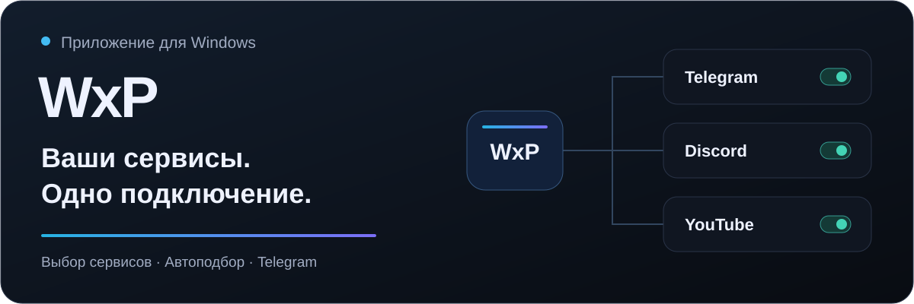

# WxP для Windows

**Выберите нужные сервисы. Остальное приложение возьмёт на себя.**

WxP объединяет подключение, подбор сервера и проверку доступности в одном окне.
YouTube, Discord, Telegram, нейросети и другие сервисы — с отдельными
переключателями и понятным состоянием подключения.

### [⬇️ Скачать WxP для Windows](https://github.com/WxP-best/WxP/releases/latest/download/WxP.exe)

[🌐 Сайт и доступ](https://wxp2026.xyz/) · [🚀 Первый запуск](docs/DOWNLOADS.md) ·
[💬 Обсуждения](https://github.com/WxP-best/WxP/discussions) · [🧭 Планы развития](ROADMAP.md)

Windows x64 · [Что нового в 1.3.1](CHANGELOG.md#131) ·
[Все выпуски](https://github.com/WxP-best/WxP/releases)

## ✨ Для чего нужен WxP

| Вам нужно | Что предлагает WxP |
| --- | --- |
| Смотреть видео и общаться | Выбор YouTube, Discord, Telegram и других сервисов прямо в окне приложения |
| Работать с нейросетями | Готовая категория для ChatGPT, Claude, Gemini, ElevenLabs и других инструментов |
| Подключить отдельную программу | Добавление своего Windows-приложения в список |
| Обойтись без перебора серверов | Автоподбор с проверкой доступности выбранных сервисов |
| Управлять всем из одного места | Подключение, состояние доступа, проверка скорости и обновления |

## 🖥️ Так выглядит приложение

  
  

Реальные экраны интерфейса 1.3.0 с демонстрационными данными.
Выбор сервисов показан фрагментом. <a href="docs/SCREENSHOTS.md">О снимках</a>

## 🎯 Чем удобен подход WxP

**Подключение под ваши задачи.** В выборочном режиме вы включаете нужные
сервисы и приложения. Остальные соединения идут по обычному пути согласно
настройкам и исключениям.

**Автоподбор с проверкой сервисов.** Приложение проверяет доступные варианты
подключения для выбранных задач. Это помогает обойтись без ручного перебора
стран; результат зависит от сети и доступных серверов.

**Два способа подключения.** Есть режим с изменением внешнего IP и отдельный
режим без его изменения. Выбор зависит от сервиса и вашей сети.

**Telegram рядом с остальными сервисами.** Подключение Telegram Desktop
встроено в приложение. Для входа в аккаунт WxP сам Telegram не обязателен —
можно использовать код доступа.

**Управление без россыпи окон.** Проверка скорости, срок доступа, обновления
и работа в трее находятся в одном приложении. Для сложных сочетаний сетевых
программ предусмотрен режим совместимости.

WxP подойдёт, если вам удобно выбирать сервисы по отдельности и управлять ими
из общего окна. Подробнее — в [обзоре возможностей и ограничений](docs/OVERVIEW.md).

## 🚀 Начать за три шага

1. **Скачайте `WxP.exe`** по кнопке выше и запустите его.
2. **Введите свой код** или нажмите «Получить доступ» в приложении.
3. **Выберите сервисы и подключитесь.** Дождитесь результата проверки.

Для интерфейса нужен Microsoft Edge WebView2, для сетевых компонентов —
права администратора. [Подробная инструкция](docs/DOWNLOADS.md).

Программа и обновления скачиваются с этой страницы. Доступ к инфраструктуре
WxP предоставляется по подписке; действующие условия видны в приложении
и на [официальном сайте](https://wxp2026.xyz/).

## 🛠️ Проект развивается

| Версия | Что появилось |
| --- | --- |
| **1.3.1** | Резерв загрузки обновлений на GitHub с проверкой файла перед установкой |
| **1.3.0** | Исправления соединений и завершения сетевых компонентов |
| **1.2.9** | Режим совместимости и TikTok в списке сервисов |
| **1.2.5–1.2.8** | Новые сервисы, выбор своих приложений и доработка подключения |

Следующие направления — надёжность на разных компьютерах, понятная
диагностика и более удобный первый запуск.
[Планы и их статус](ROADMAP.md) · [Полная история изменений](CHANGELOG.md)

## 💬 Развиваем WxP вместе

В [Discussions](https://github.com/WxP-best/WxP/discussions) можно задать вопрос,
предложить улучшение или рассказать, чего не хватает в повседневном использовании.
Начните с [путеводителя по обсуждениям](docs/COMMUNITY.md).

- 💡 **Идея или пожелание:** [предложить улучшение](https://github.com/WxP-best/WxP/discussions/categories/ideas).
- 🙋 **Вопрос о приложении:** [спросить сообщество](https://github.com/WxP-best/WxP/discussions/categories/q-a).
- 🐞 **Повторяемая ошибка:** [сообщить в Issues](https://github.com/WxP-best/WxP/issues/new?template=bug_report.yml).
- 🆘 **Доступ или оплата:** [написать в поддержку](https://t.me/blogWxP?direct).

Пожалуйста, не публикуйте коды доступа и личные данные.

## 📚 Полезное

| Начать пользоваться | Узнать подробнее |
| --- | --- |
| [Загрузка и первый запуск](docs/DOWNLOADS.md) | [Возможности и ограничения](docs/OVERVIEW.md) |
| [Частые вопросы](docs/FAQ.md) | [Данные и обращения в сеть](docs/PRIVACY.md) |
| [Сайт и инструкции](docs/WEBSITE.md) | [Как проверяются обновления](docs/UPDATES.md) |
| [Аккаунт и продление](docs/SUBSCRIPTIONS.md) | [Сторонние компоненты и лицензии](docs/THIRD_PARTY.md) |

🔎 О выпуске и безопасности

Клиент WxP разрабатывается с закрытым кодом. Этот репозиторий содержит
публичную документацию, оформление страницы и обратную связь; готовые файлы
находятся в Releases. Архив **Source code** содержит документацию.

Текущий выпуск подписан самоподписанным сертификатом, поэтому Windows может
показывать предупреждение. [О подписи](CODE_SIGNING.md) ·
[Сообщить об уязвимости](SECURITY.md) · [Область лицензирования](LICENSE.md).

Подключение и доступность отдельных функций сервисов зависят от сети,
настроек и самих сервисов. Выборочный режим не означает автоматическую
защиту всех соединений компьютера.

---

<b>Ваши сервисы. Одно подключение.</b> 
<a href="https://wxp2026.xyz/">WxP</a> ·
<a href="https://github.com/WxP-best/WxP/releases/latest">Скачать</a> ·
<a href="https://github.com/WxP-best/WxP/discussions">Обсудить</a>

