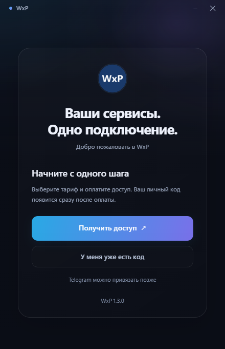
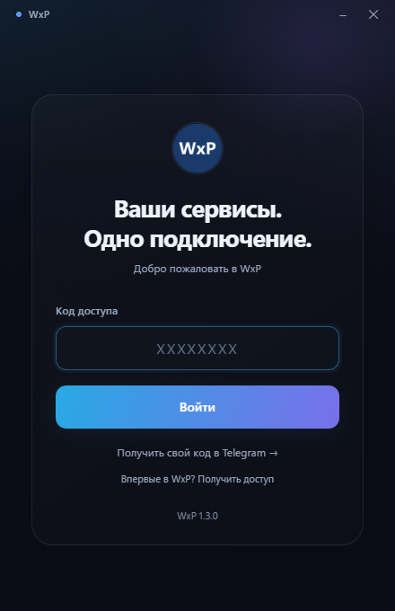
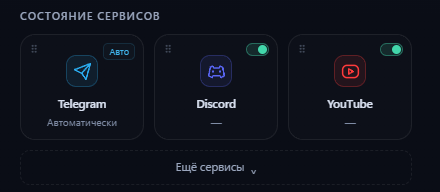

# Снимки интерфейса

Снимки подготовлены из текущих HTML/CSS/JS клиента WxP 1.3.0 в отдельном
локальном окружении с демонстрационным состоянием. Рабочий аккаунт,
подключение и личные коды при подготовке не использовались.

## Приветствие

На первом экране можно получить доступ или перейти к входу с существующим кодом.

## Вход

Поле пустое: показан обычный текст-подсказка, а не настоящий код.

## Выбор сервисов

Это отдельный фрагмент исходного экрана. Подписи интерфейса не заменялись.
Состояния доступности не изображают реальное измерение или успешное подключение.
